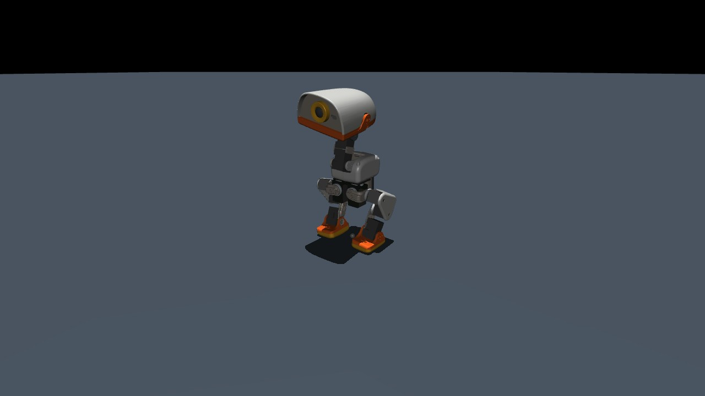
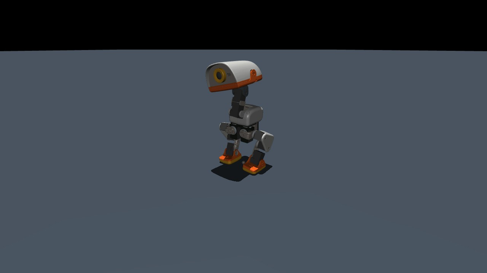

# MicroDuck dance: results (2026-11-22)

## The comparison

- **Dance:** `dances/bob-sway.json`, a 6 s head bob and sway with the feet planted. It was posed and
  recorded on `microduck-choreo` (3 cycles of JointPositions at 50 Hz), then put in the
  `microduck-dances` sequence dataset.
- **Policy:** `microduck-dance-bob-sway` 0.1.0, trained on the Parquet export by
  `Mjlab-Dance-Flat-MicroDuck` (phase-command task, `dance_pose` reward on the 100-bin reference).
- **Ours:** the `dancer` service (duck-policy in phase mode, `start {"cycles": 3}`) on
  `microduck-preview`, through `viam:mlmodel:onnx-cpu` and viam-labs:mujoco-sim 0.21.0.
- **Reference:** `scripts/duck_reference.py --phase 6.0`, which drives the same ONNX file headless in
  plain MuJoCo on the same `duck.xml`.
- **Script:** 3 cycles, then a 2 s STAND hold. Each run is 20 episodes.
- **Tools:** `scripts/duck_parity.py` (`ours`, `report`, `handover`).

## Verdict: PASS, except for host scheduling stalls

| Check | Run 1 | Run 2 | Run 3 |
|---|---|---|---|
| slip-free ≥ 18/20 | pass (20/20) | pass (20/20) | pass (20/20) |
| falls | pass (0) | FAIL (2, both overrun stops) | FAIL (3, all overrun stops) |
| joint RMSE ≤ 1.25 × ref | pass (0.0311 vs 0.0293) | FAIL (0.0394, stopped episodes included) | FAIL (0.0462, same) |
| foot drift < 3 cm | pass (2.8 mm max) | FAIL (stopped episodes only) | FAIL (stopped episodes only) |
| yaw drift < 10° | pass (0.13° max) | pass | FAIL (176° after a fall) |
| tick rate ≥ 49.5 Hz | pass (50.0) | pass (50.0) | pass (50.0) |
| p99 tick < 20 ms | pass (7.6 ms) | pass (15.9 ms) | FAIL (67.8 ms) |
| late < 1 % | pass (0) | pass (7 / 18,869) | pass (11 / 17,769) |
| policy ran every episode | pass | FAIL (episodes 18, 19: `overruns`) | FAIL (episodes 0, 10, 11: `overruns`) |
| hold after the last cycle | pass | FAIL (same episodes) | FAIL (same episodes) |
| **Handover** walker → dancer → walker | **pass, 3/3** (after the fix below) | | |

Run 1 used the code from before the `RAMP_THRESHOLD` fix; runs 2 and 3 used the code after it.
The fix can't affect these episodes. Each one starts right after a reset at STAND, where the ramp
is skipped under either threshold.

### The clean episodes agree across all three runs

| Run | Clean episodes | Joint RMSE (ref 0.0293) | Max foot drift (ref 2.8 mm) | Max yaw drift (ref 0.08°) | Phase lag | p99 tick |
|---|---|---|---|---|---|---|
| 1 | 20 | 0.0311 | 2.8 mm | 0.13° | 21 ms | 7.6 ms |
| 2 | 18 | 0.0311 | 2.9 mm | 0.14° | 21 ms | 5.7 ms |
| 3 | 17 | 0.0312 | 2.9 mm | 0.14° | 22 ms | 12.7 ms |

- **Joint RMSE** is 1.06 × the reference's. Both are measured against the 100-bin reference table.
  About 0.02 rad of it is the duck lagging its commands by roughly 25 ms, which shows up in the
  reference too.
- **Phase lag of about 21 ms:** the dancer's phase clock starts one tick after our first io read.
  That's one 20 ms slot, not drift.
- **Every clean episode** completed all 3 cycles and held STAND (`cycles_done` 3, `holding` true).

## Failure 1: overrun stops are host stalls, not the dance

In runs 2 and 3, five episodes had 3 or more late ticks in a row (the worst ticks took 58–68 ms).
The loop stopped with `overruns` as designed and held its last targets, so the duck fell within
about 1.5 s. Every other episode in those runs had a p99 tick of about 5 ms. Load average on the
development Mac was about 4 during runs 2 and 3, from other work on the machine. This is the
milestone 2 open decision again (parity results, failure 2): stopping a stale loop on a biped means
a fall. The choice between keeping `late_streak` at 3 and raising it to 5 still waits for timing on
the real duck.

Two report gaps came out of this, and neither is fixed yet:
- the phase-lag mean includes stopped episodes (2253 ms in run 3, when the clean episodes show 22 ms);
- joint RMSE and drift include the falls that follow an overrun stop.

## Failure 2 (fixed): the handover reset the world

The first handover failed with `dancer: start recovered (off_pose)`. The walker stands with
neck_pitch 0.063 rad off default, and the head joints 0.03–0.04 rad off. With the threshold at
0.05 rad, every start after a stop reset the world in sim, even walker → walker.

- **Ramp-only was tried and ruled out.** With the reset removed, the loop's 1 s ramp, which runs
  without the policy, tipped the duck over in 0.9 s (gravity z from −1.00 to −0.15). The dancer
  then stopped with `bad_action`.
- **The fix (b10e26f):** `RAMP_THRESHOLD` went from 0.05 to 0.15 rad. An upright duck within
  0.15 rad of its default pose goes straight to the new policy. Beyond that, it ramps on hardware
  and resets in sim.
- **Result:** the handover then passed 3 runs out of 3: walker stands 2 s, dancer runs 2 cycles,
  walker stands 2 s, with no fall, no reset and no stop reason.

## Training

- **Job** `6b0390d4b11eaafd4d82b6cc`: 2000 iterations, 4096 envs, seed 42, `model_1999.pt`. It
  ran 77.5 min from training start to end, on a probe-validated configuration.
- **Final rewards:**
  - `dance_pose`: 3.76 of a maximum of 4.0;
  - `feet_contact`: 0.46 of 0.5;
  - `dance_pose_l1`: −0.036;
  - `action_rate_l2`: −0.42.
- **Terminations** in the last window: `fell_over` 0.25 against `time_out` 3.875, so about 6 % of
  20 s episodes fall. That includes domain randomisation; the reference run doesn't fall.
- **Plain-MuJoCo reference:** 20 s with no fall (final trunk z 0.118). It sets
  `safety = {action_bound 0.915, max_step_rad 0.101}`.

## Frames

The `overview` camera at phases 0.25 and 0.75 of the first cycle:

## What's next

- **The overrun rule:** decide `late_streak` 3 versus 5 using timing from the real duck.
- **The report:** compute phase lag, RMSE and drift over clean episodes, and count stops separately.
- **More dances:** each new dance is a choreo session, an export and about 80 min of training.
  Nothing in the pipeline is specific to bob-sway.
- **Teleop:** the walker → dancer handover now works without a reset, so the gamepad can switch
  between them; that needs a teleop button for it.
- **One controller at a time:** `walker` and `dancer` each check only their own state, so starting
  one while the other runs gives two loops writing to the same duck. This needs fixing before the
  teleop dance button or hardware, for example with a check in `_start` that the duck isn't already
  being driven (final review, item 1).

Data (not committed): `dist/dance-reference.json`, `dist/dance-ours.json` (run 3),
`dist/dance-parity.md`, and runs 2 and 3 in the session scratchpad.
