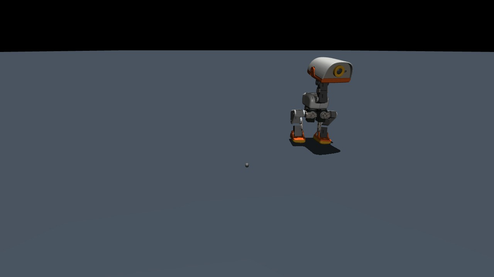

# MicroDuck velocity training: results (2026-11-21)

Milestone 3: our own MicroDuck walk policy, trained as a Viam custom training job from Pollen's
microduck_rl recipe, packaged, and run on the `microduck-preview` machine through the same stack
milestone 2 used for Pollen's `velstand`.

## The job

| | |
|---|---|
| Task | `Mjlab-Velocity-Flat-MicroDuck`, microduck_rl@0daab16, mjlab 1.3.0 |
| Image | `microduck-train:0.1.0-1` (torch 2.9.1+cu128) |
| Training script | `16518049-…:microduck-train` version 1 |
| Job | `6b023ff59d30069f0fd7efd3` (model `microduck-velocity-train` version 2) |
| Arguments | num_envs 4096, max_iterations 4000, save_interval 250, video_every_iters 500, seed 42 |
| Wall time | 2 h 42 min training (01:07–03:49 UTC), about 2.35 s per iteration |
| Final (iteration 3999) | mean reward 113.1, mean episode length 947 of 1000 steps |
| Terminations per logging window | time_out 4.04, fell_over 0.54 |
| Tracking errors | error_vel_xy 0.43 m/s, error_vel_yaw 1.12 rad/s; action std 0.19 |

- **Version 1 died at iteration 2690** with Viam `code 14 "The service is currently unavailable"`
  after 1 h 43 min. The training metrics were healthy and there was no traceback, so it was the
  platform. Resubmitted unchanged as version 2, which followed the same curve.
- **Probe (200 iterations, before the real job):** passed every check on the first try:
  - CUDA and EGL both work on the A100, so training videos render on the GPU;
  - about 2.4 s per iteration at 4096 envs, after a 6 s first iteration and about 3 min of startup;
  - the export was verified with the right metadata;
  - the video upload to Viam Data worked.
- **Export checks:** `policy.onnx` passes `verify_onnx` (obs [1,61] → actions [1,14], joint order).
  The metadata pose is within 3e-4 of STAND (limit 6e-4), and `config.json` carries STAND exactly.

## Speed sweeps

8 s of a constant command from the reset pose through Pollen's reference
(`scripts/duck_speed_sweep.py`). Each cell is the measured mean body vx (m/s) and wz (rad/s) over
t > 3 s. Neither policy fell in any case.

| cmd vx | cmd wz | ours vx | ours wz | velstand vx | velstand wz |
|---|---|---|---|---|---|
| +0.10 | 0 | 0.000 | −0.001 | 0.000 | 0.000 |
| +0.20 | 0 | 0.073 | −0.035 | 0.000 | 0.000 |
| +0.30 | 0 | 0.138 | −0.165 | 0.098 | 0.023 |
| +0.40 | 0 | 0.204 | −0.329 | 0.169 | −0.019 |
| −0.20 | 0 | −0.090 | −0.136 | 0.000 | −0.003 |
| −0.40 | 0 | −0.228 | −0.295 | −0.151 | −0.106 |
| 0 | +0.30 | 0.000 | −0.001 | 0.000 | 0.001 |
| 0 | −0.30 | 0.000 | −0.001 | 0.000 | −0.001 |
| 0 | +0.60 | 0.012 | 0.491 | 0.000 | 0.003 |
| 0 | −0.60 | 0.000 | −0.003 | 0.000 | −0.008 |
| 0 | +1.00 | 0.024 | 0.859 | 0.018 | 0.510 |
| 0 | −1.00 | 0.033 | −0.806 | 0.000 | −0.004 |
| +0.20 | +0.30 | 0.069 | 0.242 | 0.000 | 0.001 |
| +0.20 | −0.30 | 0.000 | −0.001 | 0.000 | 0.000 |
| +0.20 | +0.60 | 0.066 | 0.569 | 0.000 | 0.009 |
| +0.20 | −0.60 | 0.075 | −0.575 | 0.070 | −0.190 |
| +0.20 | +1.00 | 0.056 | 0.871 | 0.065 | 0.605 |
| +0.20 | −1.00 | 0.103 | −1.147 | 0.064 | −0.432 |

- **Ours is more responsive than velstand.** Its dead zone is smaller: it walks from vx 0.2 and
  backward from −0.2, and it turns in place both ways at ±1.0. It tracks turns closely, but forward
  speed reaches only about half the command.
- **Ours drifts in yaw while walking straight:** −0.33 rad/s at vx 0.4 and −0.30 at vx −0.4, against
  velstand's −0.02 and −0.11. This matches the high training `error_vel_yaw` (1.12 rad/s). It's the
  biggest weakness of this policy, and the first thing to address in a retrain (more iterations, or
  a heavier `track_angular_velocity` weight).
- **Some edges are bistable**, as with velstand: in-place −0.6 and vx 0.2 with −0.3 stand still,
  while their mirror commands move.

The parity script was chosen from our own sweep (`scripts/parity_velocity.json`): stand 2 s; vx 0.4
for 8 s; vx 0.2 with wz +0.6 for 5 s; vx 0.2 with wz −0.6 for 5 s; stop 4 s; vx −0.4 for 6 s.

## Package

`microduck-velocity` 0.1.0 is in DevRelDemos as an `ml_model` (onnx, robot_policy). It contains:
- `policy.onnx`;
- the job's `config.json`, with the safety block from our reference run of the parity script:
  `action_bound` 1.817 and `max_step_rad` 1.144 (velstand: 1.853 and 1.252);
- `LICENSE-POLICY.md`, which says it was trained by us from Pollen's Apache-2.0 recipe and that the
  meshes aren't included.

The preview machine's `walk-model` and `walker` point at it (`duck-sim-machine.json`).
`microduck-walk` stays in the packages list, so switching back is one edit. Smoke test
(`scripts/duck_smoke.py --vx 0.4`):
- **Standing 10 s:** 499 ticks, p99 7.0 ms, no late ticks, gravity z −1.000.
- **Walking 5 s:** the trunk moved 0.67 m and stayed upright.

## Parity: strict FAIL on one cell, every other check passes

Our stack (20 episodes) against Pollen's reference on the same ONNX, script and `duck.xml`
(`dist/duck-parity-velocity.md`).

| Check | Result |
|---|---|
| slip-free ≥ 18/20 | pass (20/20) |
| falls ≤ ref + 1 | pass (0; reference 0) |
| RMSE vs command ≤ 1.25 × ref (vx / wz) | pass (0.149 vs 0.150 / 0.625 vs 0.637) |
| tick rate ≥ 49.5 Hz | pass (50.0 Hz) |
| p99 tick < 20 ms | pass (7.29 ms worst episode) |
| late < 1 % | pass (5 / 30,013) |
| walker ran every episode | pass |
| segments 0–5 vx, segments 0–4 wz: mean within tolerance, ≤ 2 outliers | pass |
| segment 5 (backward) wz | **FAIL**: mean passes (−0.300 vs −0.271, tolerance 0.08), but 3/20 outliers (episodes 1, 6, 11) |

| Segment | Reference vx / wz | Ours vx / wz (mean of 20) |
|---|---|---|
| 0 stand | 0.000 / −0.001 | 0.000 / 0.000 |
| 1 forward 0.4 | 0.196 / −0.331 | 0.201 / −0.351 |
| 2 vx 0.2 + turn left | 0.070 / 0.593 | 0.063 / 0.549 |
| 3 vx 0.2 + turn right | 0.078 / −0.548 | 0.080 / −0.568 |
| 4 stop | 0.000 / −0.001 | 0.000 / 0.001 |
| 5 backward 0.4 | −0.229 / −0.271 | −0.232 / −0.300 |

### The failing cell is the policy's uncommanded yaw drift

- **The wz in segment 5 is drift, not tracking:** the command is wz 0. It's the yaw drift from the
  sweep, and it varies with the stance the duck happens to be in when it starts backing up.
- **Our 20 episodes range continuously** from −0.23 to −0.42 rad/s. The outliers are the tail, not a
  separate mode: −0.42, −0.40 and −0.36, against the −0.351 limit.
- **The reference spreads the same way when nudged.** With ±0.01 rad of uniform joint noise at
  t = 24 s (the backward start), over 20 seeds (`scripts/duck_perturb_ref.py`):
  - its segment-5 wz ranges from −0.21 to −0.37, mean −0.275, with 1/20 past the limit;
  - its vx stays at −0.23 ± 0.01, as ours does.
- **Our spread is somewhat wider,** plausibly because our stack's real-time jitter perturbs the whole
  episode rather than one tick.
- **No sign of a stack mismatch.** Every mean is within tolerance, and the tracking RMSEs are within
  1 % of the reference. The timing is better than milestone 2's: p99 7.3 ms against 13.7, and 5 late
  ticks against 17.

### Compared with milestone 2 (velstand)

| | velstand (milestone 2) | microduck-velocity (ours) |
|---|---|---|
| Falls | 1 / 20 (an overrun stop) | 0 / 20 |
| Backward segment | 6/20 outliers, 5 stood still (a basin of attraction) | 20/20 walked back; 3/20 drift outliers |
| Overruns | 1 episode | none |
| RMSE ratio vx / wz | 1.05 / 1.02 | 0.99 / 0.98 |

## Follow-ups

- **Yaw drift when walking straight:** the policy's main weakness. Address it in a retrain.
- **The overview camera is fixed on the origin,** so a 5 s forward walk leaves the frame. The frame
  above is from a turning walk.
